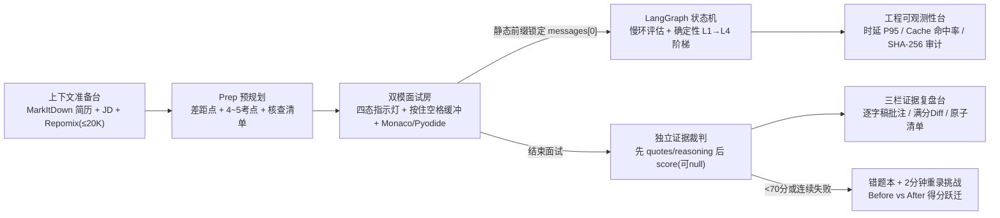

# interview-helper

面向工程师的高辨识度 **AI 模拟面试系统**（已交付 **P0 最小可用闭环 + P1 作品集强化模块**）。
摒弃粗糙 2D/3D 数字人与浅层题库问答，聚焦 **GitHub 源码级压力深挖、确定性四级追问阶梯、静态前缀缓存、思考缓冲友好交互、零后端 Pyodide 代码沙箱、错题 2 分钟重录训练与证据锚定复盘台**。

---

## 1. 系统总览与核心模块



### 已交付功能清单（P0 + P1）
- **上下文准备台 (`/`)**：`MarkItDown` 解析 PDF/MD 简历；`Repomix --compress` 提取 GitHub 仓库 AST 骨架并严格控制 `≤ 20,000` Tokens；支持「温和引导 / 大厂高压拷打」两档风格。
- **确定性四级追问状态机**：`L1 概念原理 → L2 个人实战 → L3 底层细节/代码实现 → L4 极端边界与故障排查`，回答质量分 `≥ 0.65` 自动升级施压，连续两轮不达标才记错切题。
- **极简语音/文本双模面试房 (`/interview/[id]`)**：极简 Canvas 声波 + 四态指示灯（`倾听中` / `检测到思考停顿，继续等你` / `AI 思考中` / `AI 发言中`）、按住空格暂缓提交、可插拔 `edge-tts >= 7.3.1`（含 0 字节检测与 `Web Speech` 兜底）及 `OpenAI STT`。
- **零后端 Pyodide 在线编程沙箱**：内嵌 Monaco Editor + 独立 Pyodide WebWorker（含 15s 超时强杀保护），运行单测并将代码快照与结果附着至当轮尾部供 AI 追问与赛后 `code_and_testing` 评判。
- **证据锚定复盘台 (`/report/[id]`)**：Pydantic v2 校验 + 最多 2 次自动重试；强制先引用原话时间戳再打分，未考维度诚实输出 `N/A (null)`；确定性 Python 统计语速、最长冷场停顿秒数与填充词频次。
- **错题本与 2 分钟单题重录 (`/mistakes`)**：自动沉淀低分考点，支持 120s 倒计时重录挑战并展示前后得分跃迁与新达标核查项。
- **工程可观测性台 (`/observability`)**：展示跨场次 Prompt Cache 命中率曲线、四阶段平均/P95 延迟与费用拆解、单场 `static_prefix_sha256` 零漂移审计。
- **BYOK 与离线 Mock 模式 (`/settings`)**：三阶段独立配置 `base_url`、`api_key` 与 `model`（支持一键拉取 `/v1/models`），内置零 API Key 的完整离线 `MockAdapter`。

---

## 2. Architecture Decision Records (ADR)

### ADR-001：为什么采用「快慢双环 + 确定性 L1–L4 阶梯」，而不是把整场面试交给单个 Prompt？
直接让一个对话 Prompt 自行决定何时深挖、何时切题，通常会在 5–8 轮后出现人设漂移、对候选人过度客气或过早放水切题。我们将职责解耦：每轮先由慢环评估器对当前答复打出 `0.0–1.0` 质量分，再由纯确定性 Python 状态机 (`compute_next_ladder_state`) 硬约束 `L1 → L2 → L3 → L4` 晋级与连续两轮 `< 0.65` 切题条件，最后才由面试官模型生成提问。

### ADR-002：为什么在 ≤20K 个人源码场景下用 `Repomix + Static Prefix Caching` 替代向量 RAG？
面向单场个人模拟面试，若每轮用向量数据库检索不同 Top-K 代码片段插进系统提示词，不仅容易漏掉跨文件中间件逻辑，更会每轮破坏 Prefix Cache 连续性。本系统将 `系统人设 → 字典序固定工具 JSON → 简历 → 冻结 Prep 题纲 → Repomix AST 源码` 锁死在 `messages[0]` 静态前缀（严禁混入时间戳、UUID 与轮次计数），仅在尾部用户消息附加动态状态指令与代码快照，使前缀哈希在单场全程保持 100% 字节一致。

### ADR-003：为什么坚持极简声波 + 思考缓冲 + `edge-tts` 0 字节防崩兜底？
低质量 2D/3D 数字人不仅分散注意力，还易引发恐怖谷效应；而固定 500ms 静音断句会粗暴打断候选人的架构思考。我们采用克制的极简声波与四态指示灯，配合按住空格暂缓提交机制把节奏控制权交回候选人；针对免费语音服务不稳定的痛点，在 `EdgeTTSProvider` 中内置 0 字节检测与异常捕获，一旦异常立即通过 `X-TTS-Fallback: web_speech` 无缝切换至浏览器原生 `speechSynthesis`。

---

## 3. 快速启动

### 方式一：一键 Docker Compose（推荐零配置试用）
默认开启 `MOCK_MODE=true`（无需 API Key 即可跑通完整流程），SQLite WAL 数据持久化在 `./data`：
```powershell
docker compose up --build
```
访问 `http://127.0.0.1:3000`（若需对接本机中转模型，可在启动时传入 `MOCK_MODE=false` 并在设置页填入接口）。

### 方式二：本地源码启动（开发调试）
```powershell
# 1. 启动后端（FastAPI + LangGraph + SQLite WAL）
cd D:\AIagent\interview-helper\backend
$env:UV_CACHE_DIR="D:\code_program\uv_cache"
uv sync --python 3.12
.\.venv\Scripts\uvicorn.exe app.main:app --host 127.0.0.1 --port 8000 --reload

# 2. 启动前端（另开终端）
cd D:\AIagent\interview-helper\frontend
npm install
npm run dev
```

### 4. 运行自动化回归测试（20 项）
```powershell
cd D:\AIagent\interview-helper\backend
.\.venv\Scripts\python.exe -m pytest -v
```
